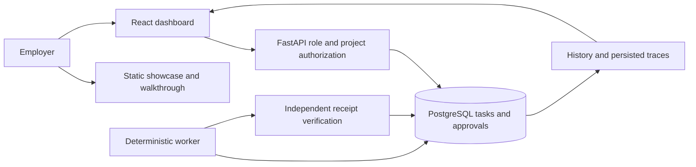

# Portfolio foundation

The GitHub Project Showcase with a Guided Hands-On Demo belongs to ai-engineering-portfolio. The eight technical repositories remain independently runnable. Project 08, Agent Operations Control Center, is the first employer demo.

## Repository structure

```text
README.md                         Start Here entry and delivery history
showcase/projects.json            Eight project records and evidence pointers
docs/FOUNDATION.md                Scope, dependencies and section gates
docs/GUIDED-DEMO.md               Real application startup and five demo steps
docs/DEVELOPMENT-WORKFLOW.md       Milestone capture and completion process
templates/milestone.json          Reusable development evidence record
resume/2026.md                    Initial evidence-based resume draft
site/                            Generated GitHub Pages compatible static site
scripts/build_showcase.py         Rebuild site from the project inventory
scripts/verify_foundation.py      Inventory, evidence and local link checks
evidence/                        Existing verified checkpoint records
```

## Section gates

Complete the current section before implementing its successor. A later section passes only after its own checks succeed; existing project CI does not validate new showcase changes.

| Section | Deliverables and dependencies | Exit checks | State |
| --- | --- | --- | --- |
| 1 Foundation | Existing repositories, eight-project inventory, evidence mapping, first demo instructions, site skeleton | Existing evidence verifier passes; eight inventory entries match recorded commits and successful runs; local navigation works; gaps listed | Passed locally on October 14, 2026; evidence/foundation-validation.json |
| 2 Evidence workflow | Uses section 1 inventory; milestone schema, capture command and reviewed example | Reject invalid records and secret-bearing input; validate one captured milestone; establish review ownership | Planned; templates only |
| 3 Demo environment | Uses Project 08 scripts and section 2 evidence capture; devcontainer, private forwarded port, environment-generated credentials | Fresh Codespaces build, restart, clean startup and actual HTTP/browser checks pass; no secrets in output | Fresh unattended startup, both lifecycle hooks, full runtime checks and private forwarded-URL task/receipt/trace inspection passed at portfolio commit 90ae4dc4; evidence/codespaces-operational/manifest.json |
| 4 Guided walkthrough | Uses working section 3 environment and these instructions | Employer completes all five actions with expected receipt, roles, retry and trace results | Eight HTTP and eight Chromium scenarios passed; authenticated forwarded creation/receipt, mismatch and trace inspection also passed |
| 5 Showcase | Uses verified walkthrough; complete pages, eight cards, project README links | Browser, keyboard, mobile, broken-link and public access checks pass | Foundation preview only |
| 6 Resume | Uses reviewed milestone contributions | Owner reviews personal attribution, AI assistance, tradeoffs and each evidence-backed bullet | Initial draft only |
| 7 Publication | All previous gates pass | Pages deployment verified; all project Start Here links resolve; trial project completion updates site and resume | Planned |

## Evidence policy

showcase/projects.json points to preserved evidence records. CI links describe the exact recorded commit and verification time, not current branch health. Raw GitHub artifacts have a recorded 14-day retention period; retained summaries and checksums remain useful after expiry, but do not recreate expired raw evidence.

Project 01 was private at its recorded checkpoint; source and CI may require employer access. Current visibility has not been rechecked. All eight project inventories include explicit gaps. Existing projects are not integrated into Project 08 at runtime.

## Hosting boundary

[GitHub Pages](https://docs.github.com/en/pages/getting-started-with-github-pages/what-is-github-pages) serves site/ as static HTML, CSS and JavaScript at https://texasbredmj.github.io/ai-engineering-portfolio/. The application runs separately in [Codespaces](https://docs.github.com/en/codespaces/setting-up-your-project-for-codespaces). Fresh unattended startup and the full working demo passed at portfolio commit 90ae4dc4 on October 14, 2026. The Pages site uses a separate gh-pages branch; the source changes remain in the verification pull request.

## First demo architecture



The UI, API and worker run in the demo environment. No backend credentials or database connection belong in the static site.
