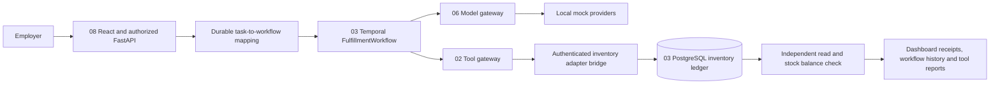

# Integrated employer platform

The portfolio is the employer entry point. Its Codespace starts one Compose stack and forwards only dashboard port 18780, with private visibility. Backend services and database ports stay on the internal Compose network.

Creating a dashboard task authorizes a bounded fixture reservation. Approval tasks wait for a separately authenticated approver before dispatch. The dispatcher starts the existing Project 03 workflow and submits its signed approval only after the dashboard's policy gate. The gateway performs an additional argument-bound tool approval, then invokes an authenticated fixed inventory endpoint. The bridge requires the workflow's durable grant and exact normalized request. A separate GET verifies the adapter result; the orchestrator independently reads the ledger, reservation event count and stock balance before declaring completion.

The dashboard effect row is a projection, not a second inventory mutation. The workflow ID is retained across dispatcher replacement; Temporal rejects duplicate workflow creation, and the ledger deduplicates reservations by that identity. An explicit eligible retry creates a new attempt only after its prior workflow has failed. Gateway and model reports appear under Tools and independent evidence under Evidence. Workflow state transitions and correlated projection spans remain inspectable.

Transient/permanent quote failures and intentional quantity corruption are explicit fixture scenarios. Failed quantity verification triggers the original orchestrator's compensation. Local mock providers exercise the real model gateway and Redis budget ledger; they do not call a paid model endpoint. Dashboard model spending stays zero; hypothetical gateway token/cost accounting is available inside its report.

Projects 01, 04, 05 and 07 are engineering tools, not additional dashboard servers. `python scripts/project_demo.py all` runs their real maintenance, evaluation mutation, fault recovery and release-gate demonstrations, plus the service projects and integrated walkthrough. All eight source snapshots are available under `projects/`, including the first project's authorized employer snapshot; its original private repository visibility is unchanged. `projects/source-manifest.json` preserves the original source commits. Changes to the gateway's inventory adapter and the dashboard are reviewed here as integration changes.

Generated role tokens and service credentials remain in ignored `.platform/.env`. An employer should keep their Codespace port private and stop the Codespace after trying it. Production managed identity, hostile-code isolation and arbitrary external API exactly-once effects are outside this fixture demonstration.
