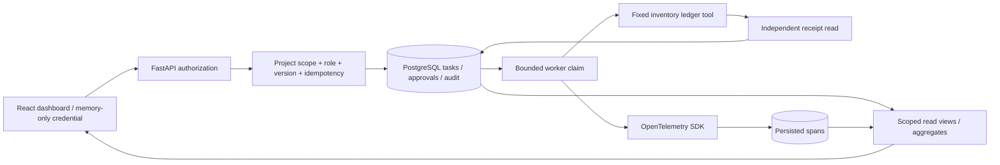

# Architecture

The public root serves static assets and a credential form; only readiness is available without
authentication. Every operational endpoint resolves a configured principal from a bearer token.
Project scope is applied before returning a task or replaying its control response. Reads, controls
and aggregates share backend authorization. [FastAPI security dependencies](https://fastapi.tiangolo.com/reference/security/)
provide bearer parsing; constant-time digest comparison checks the configured opaque token.

Task creation and command handling run in transactions. Advisory locks serialize each project's
idempotency keys; a separate project lock makes the task-capacity check atomic. Controls lock the task
and compare its version before changing state. Exact command replay precedes version checking and
returns the stored JSON response. A different actor/body/action cannot reuse the key. Approval hashes
bind task identity, fixed tool and quantity; decisions and state transitions commit together.

Workers claim queued tasks using
[PostgreSQL row locking and SKIP LOCKED](https://www.postgresql.org/docs/current/sql-select.html),
increment attempts and persist a claim token/lease before execution. The process exposes a one-second
cancellation window between claim and finish. Finish locks the row again and checks state, claim token
and lease. Cancellation during that window invalidates the claim. After a committed effect/completion,
the task is terminal and cancellation cannot misrepresent rollback. Lease recovery fences the old
worker and stops requeueing after the maximum attempt count.

The deterministic tool inserts one `effects` row per task. The verifier separately reads the ledger
and compares expected and observed quantities; it never trusts `claimed_completed`. The tool call,
verification evidence, audit event and terminal transition share one transaction. A unique task key
prevents duplicate ledger effects. An intentionally incorrect receipt remains available for diagnosis
and blocks retry. External API effects would need their own receipts, reconciliation and idempotency.

OpenTelemetry's synchronous exporter collects actual execution spans and writes them in the same
transaction. The stable task trace ID links creation, attempts and independent verification spans;
SDK spans point to the stored creation parent. No network telemetry exporter is configured. Failed
transactions roll back their associated spans, so traces alone are not a crash-attempt log; durable
claim/lease events record interrupted attempts. Resource counters come from psutil on the worker.

React polling follows [Effect cleanup guidance](https://react.dev/reference/react/useEffect): changing
session, selection, filter or page cancels the old refresh loop and ignores its late results. No
credential is persisted in browser storage. Writes use POST with explicit reasons/versions; the UI
displays actions appropriate to the role while the API independently rejects unauthorized requests.

## Contract summary

| Method / path | Purpose |
| --- | --- |
| GET `/api/me` | Configured principal, role and project |
| GET `/api/tasks?state=ACTIVE&limit=50&offset=0` | Scoped server-filtered task page |
| GET `/api/tasks/{uuid}` | Task, approval, history, tools, spans and receipt evidence |
| GET `/api/overview` | Scoped state/verification/usage totals and shared worker health |
| POST `/api/tasks` | Operator-only typed fixture intake, idempotency key required |
| POST `/api/tasks/{uuid}/{approve,reject,cancel,retry}` | Role/state/version-bound command |

Schema changes currently use one initial idempotent schema file. Versioned migrations are a future
production requirement. Each project is capped at 1,000 fixture tasks, and pages at 100 items.
